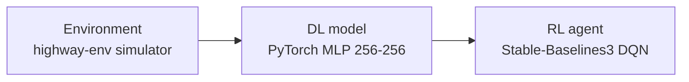
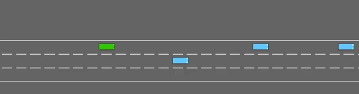
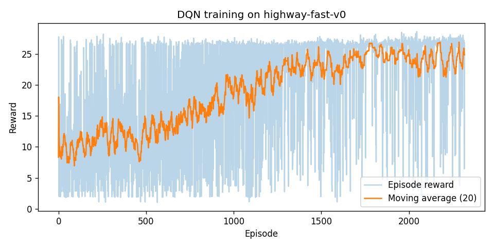

# Autonomous Highway Driving with Deep Reinforcement Learning

[](https://colab.research.google.com/github/bablu2023/rl-highway-driving/blob/main/notebooks/run_in_colab.ipynb)

A self-driving car agent that learns to drive **fast and safely on a busy multi-lane highway**,
built with **highway-env** (driving simulator), **PyTorch** (neural network) and
**Stable-Baselines3** (DQN agent).



## The problem

The green car (ours) drives on a 3-lane highway (highway-fast-v0) with other vehicles.

| | |
|---|---|
| **Observation** | position and velocity of our car and the 4 nearest vehicles (a 5 × 5 table, "Kinematics") |
| **Actions** (5) | `LANE_LEFT`, `IDLE`, `LANE_RIGHT`, `FASTER`, `SLOWER` |
| **Reward** | higher for driving fast and in the right-hand lane; a crash gives a penalty and ends the episode |
| **Episode ends** | on a crash, or when the time limit is reached |

The agent has to learn to trade off **speed** against **safety**: overtake slow cars without crashing.

## How it works

1. **Environment** (`src/env.py`): `highway-fast-v0`, a faster-simulating version of `highway-v0` used for training.
2. **Model**: a fully-connected neural network (25 inputs → 256 → 256 → 5 Q-values), built by Stable-Baselines3 (`MlpPolicy`).
3. **Agent** (`train.py`): Deep Q-Network (DQN) with:
   - **Replay buffer** (15,000 steps): learns from random past experiences.
   - **Target network**, updated every 50 steps, for stable learning targets.
   - **ε-greedy exploration**: random actions at first, then fewer over the first 70% of training.
   - **γ = 0.8**: focuses on near-term rewards, which suits fast-changing traffic.

## Project structure

```
rl-highway-driving/
├── README.md
├── requirements.txt
├── train.py                  # train the agent, save model + reward plot
├── evaluate.py               # test (trained or random), crash rate, video
├── src/
│   ├── __init__.py           # package marker (+ rendering note)
│   └── env.py                # driving environment
├── notebooks/
│   └── run_in_colab.ipynb    # run everything in Google Colab
└── results/                  # model, plots, videos are saved here
```

## Run in Google Colab (easiest)

Click the **Open in Colab** badge at the top, then Runtime → Run all.

## Run locally

```bash
git clone https://github.com/bablu2023/rl-highway-driving.git
cd rl-highway-driving
python -m venv .venv && source .venv/bin/activate     # Windows: .venv\Scripts\activate
pip install -r requirements.txt
python evaluate.py --random --episodes 10             # baseline: random driver
python train.py --steps 20000                         # train the agent
python evaluate.py --episodes 20                      # trained driver + results/agent.mp4
```

## Results

Tested on 20 episodes with fixed seeds (random driver: 10 episodes).

| Driver | Training | Crash rate | Avg speed (m/s) | Mean reward* |
|---|---|---|---|---|
| Random | none | 90% | 24.8 | 7.01 |
| DQN | 20,000 steps, γ = 0.8 | 30% | 24.7 | 21.29 |
| DQN | 50,000 steps, γ = 0.8 | 40% | 27.1 | 21.95 |
| **DQN (safe)** | **50,000 steps, γ = 0.95, collision reward −3** | **0%** | **21.1** | 26.76 |

*Mean rewards are only comparable between runs with the same reward settings.

**What we learned:**
- With γ = 0.8 the agent looks only ~5 steps ahead, so it barely "sees" that a crash ends the episode and loses all future reward. Training longer made it faster but also crash more.
- Raising γ to 0.95 (looks ~20 steps ahead) and tripling the crash penalty produced a careful driver with **zero crashes** in 20 test episodes, at the cost of lower speed: the classic **safety vs. speed trade-off** in autonomous driving.
- Inspecting its Q-values shows why: highway-env only rewards speed above 20 m/s, and the safe agent judged that small bonus not worth the crash risk, so it settles in the right lane near 20 m/s.





## Ideas to extend

- Train longer (`--steps 50000`) and compare crash rates.
- Make traffic denser: `make_env(config={"vehicles_density": 1.5})`.
- Try other scenarios: `merge-v0`, `roundabout-v0`, `intersection-v0`.
- Compare algorithms: DQN vs PPO (`from stable_baselines3 import PPO`).

## Credits

Simulator: [highway-env](https://github.com/Farama-Foundation/HighwayEnv) by Edouard Leurent / Farama Foundation.
DQN settings follow the highway-env Stable-Baselines3 example.
