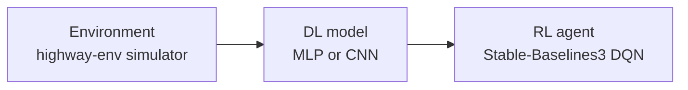
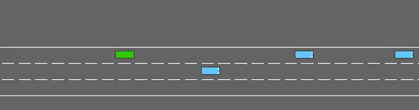
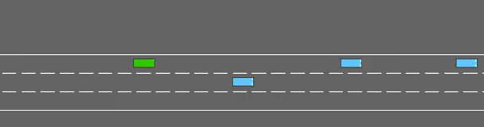
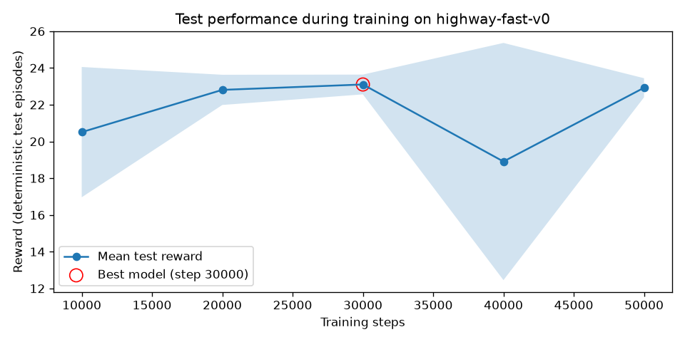
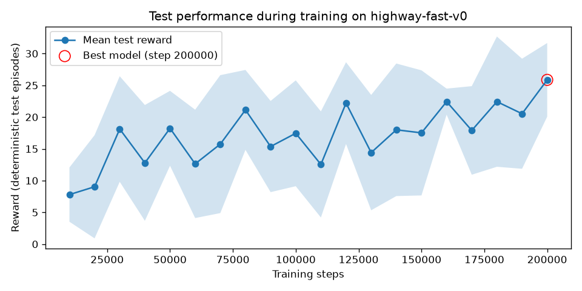

# Autonomous Highway Driving with Deep Reinforcement Learning

[](https://colab.research.google.com/github/bablu2023/rl-highway-driving/blob/main/notebooks/run_in_colab.ipynb)

A self-driving car agent that learns to drive **fast and safely on a busy multi-lane highway**,
built with **highway-env** (driving simulator), **PyTorch** (neural network) and
**Stable-Baselines3** (DQN agent). It learns either from a table of nearby cars' positions
or directly from **camera images** with a CNN, and was trained on NVIDIA H100 GPUs.



## Best agents

| Best table-based driver (8% crashes, 22.1 m/s) | Best camera-based driver (25% crashes, 28.1 m/s) |
|---|---|
|  |  |
| Overtakes slower cars with frequent lane changes | Drives fast and reacts to traffic from pixels alone |

Our car is **green**, other traffic is **blue**. Full results and what we learned are [below](#results).

## The problem

The green car (ours) drives on a 3-lane highway (highway-fast-v0) with other vehicles.

| | |
|---|---|
| **Observation** | either a 5 × 5 table of position and velocity of our car and the 4 nearest vehicles ("Kinematics"), or 4 stacked 128 × 64 grayscale camera images |
| **Actions** (5) | `LANE_LEFT`, `IDLE`, `LANE_RIGHT`, `FASTER`, `SLOWER` (target speeds 20 / 25 / 30 m/s) |
| **Reward** | each step, scaled to 0–1: higher for driving fast (above 20 m/s) and in the right-hand lane; a crash gives a penalty and ends the episode |
| **Episode ends** | on a crash, or when the time limit is reached |

The agent has to learn to trade off **speed** against **safety**: overtake slow cars without crashing.

## How it works

1. **Environment** (`src/env.py`): `highway-fast-v0`, a faster-simulating version of `highway-v0` used for training.
2. **Model**: a fully-connected network (MLP, 25 inputs → 256 → 256 → 5 Q-values) for the table, or a convolutional network (CNN) for camera images.
3. **Agent** (`train.py`): Deep Q-Network (DQN) with:
   - **Replay buffer** (15,000 steps): learns from random past experiences.
   - **Target network**, updated every 50 steps, for stable learning targets.
   - **ε-greedy exploration**: random actions at first, then fewer over the first 70% of training.
   - **Best-model saving**: every 10,000 steps the agent is tested without exploration, and the best version is kept as `best_model.zip`. DQN can collapse late in training, so this matters.

## Project structure

```
rl-highway-driving/
├── README.md
├── requirements.txt
├── train.py                  # train the agent, save final + best model and plots
├── evaluate.py               # test (trained or random): crash rate, speed, actions used, video
├── show_camera.py            # picture of what the camera-based agent sees
├── make_gif.py               # turn a result video into a GIF for this README
├── camera.pbs                # PBS job script for the GPU cluster
├── src/
│   ├── __init__.py           # package marker (+ rendering note)
│   └── env.py                # driving environment (table or camera observations)
├── notebooks/
│   ├── run_in_colab.ipynb    # run everything in Google Colab
│   └── camera_in_colab.ipynb # train the camera-based (CNN) agent
└── results/
    ├── best_table/           # best table-based agent: model, settings, plots, GIF
    └── best_camera/          # best camera-based agent: model, settings, plots, GIF
```

## Run in Google Colab (easiest)

Click the **Open in Colab** badge at the top, then Runtime → Run all.

## Run locally

```bash
git clone https://github.com/bablu2023/rl-highway-driving.git
cd rl-highway-driving
python -m venv .venv && source .venv/bin/activate     # Windows: .venv\Scripts\activate
pip install -r requirements.txt
python evaluate.py --random --episodes 10             # baseline: random driver
python train.py --steps 20000                         # train the agent
python evaluate.py --episodes 20                      # trained driver + results/agent.mp4
```

### Watch the best agents (no training needed)

```bash
python evaluate.py --model results/best_table/best_model.zip --episodes 20 --video best_table.mp4
python evaluate.py --model results/best_camera/best_model.zip --episodes 20 --video best_camera.mp4
```

`evaluate.py` reads the matching `env_config.json` next to each model, so the reward settings and
observation type are set up automatically.

## Results

All experiments: DQN on `highway-fast-v0`, γ = 0.95 and collision reward −3 unless noted.
Crash rates come from fixed test seeds (20 episodes, or 100 where marked).

### 1. First runs: faster vs. safer

| Driver | Training | Crash rate | Avg speed (m/s) |
|---|---|---|---|
| Random | none | 90% | 24.8 |
| DQN, γ = 0.8, collision −1 | 20,000 steps | 30% | 24.7 |
| DQN, γ = 0.8, collision −1 | 50,000 steps | 40% | 27.1 |
| DQN, γ = 0.95, collision −3 | 50,000 steps | 0% | 21.1 |

With γ = 0.8 the agent looks only ~5 steps ahead, so it barely "sees" that a crash ends the episode.
Raising γ to 0.95 and tripling the crash penalty gave **zero crashes**, but the agent drove at almost
the minimum speed.

### 2. Reward hacking: the agent that only brakes

`evaluate.py` reports which actions an agent uses. That revealed what the "safe" agents were really doing:

| Agent | Crash rate | Avg speed | Actions used |
|---|---|---|---|
| Camera, 100,000 steps | 0% | 20.0 m/s | **SLOWER 100%** |
| Camera, 200,000 steps (final) | 100% | 27.9 m/s | **FASTER 89%** |

Both learned a fixed habit that ignores the camera. Braking forever is "safe" and still scores almost
as much as real driving, because of how highway-env scales the reward: each step's reward is mapped to
0–1 between the crash penalty and `high_speed_reward + right_lane_reward`. With a crash penalty of −3
and the default `high_speed_reward` of 0.4, driving at 30 m/s earns only **~11% more** per step than
crawling at 20 m/s. The agent optimised exactly the reward it was given: a classic case of **reward hacking**.

### 3. The speed-reward dial

Raising `--high-speed-reward` makes speed worth more (+24% per step at 1.0, +39% at 2.0):

| Agent (best model) | Speed reward | Crash rate | Avg speed (m/s) | Actions used |
|---|---|---|---|---|
| Table, 50,000 steps | 0.4 (default) | 0% | 21.1 | mostly SLOWER |
| **Table, 50,000 steps** | **1.0** | **8%** (100 episodes) | **22.1** | lane changes 66%, IDLE 19%, SLOWER 12%, FASTER 3% |
| Table, 50,000 steps | 2.0 | 12% (100 episodes) | 23.1 | lane changes 46%, SLOWER 35%, FASTER 19% |
| Camera, 200,000 steps | 0.4 | 0% | 20.4 | SLOWER 93% |
| Camera, 200,000 steps | 1.0 | 0% | 20.1 | SLOWER 98% |
| **Camera, 200,000 steps** | **2.0** | **25%** | **28.1** | FASTER 43%, lane changes 38%, SLOWER 14% |

With a higher speed reward the agents stop crawling and actually **drive**: they overtake with lane
changes and adjust their speed to the traffic. Pushing speed further makes them faster but riskier.
At speed reward 1.0, the best camera model is still the crawler (its final model drove actively but
crashed 35% of the time), because the "best" model is chosen by reward, and crawling safely still
scored slightly higher.

### 4. Table vs. camera: the perception gap

At similar settings the camera agent crashes **25–35%** of the time, versus **8–12%** for the
table agent. The only difference is perception: the table agent is *given* exact positions of the
nearest cars, while the camera agent must work them out from low-resolution grayscale images with a
limited view of the road. This gap between perfect information and learning from sensors is the core
challenge of real self-driving.

### Training curves

| Table agent, speed reward 1.0 | Camera agent, speed reward 2.0 |
|---|---|
|  |  |

## Driving from camera images

[](https://colab.research.google.com/github/bablu2023/rl-highway-driving/blob/main/notebooks/camera_in_colab.ipynb)

With `--obs camera` the agent receives **grayscale top-view camera images** (128 × 64 pixels,
the last 4 frames stacked so it can perceive motion), and the neural network becomes a
**CNN** that has to learn by itself to recognise cars and lanes in pixels.

```bash
python show_camera.py                                   # save results/camera_view.png
python train.py --obs camera --steps 200000 --gamma 0.95 --collision-reward -3 --high-speed-reward 2.0 --out results_camera
python evaluate.py --model results_camera/best_model.zip --episodes 20
```

Image-based training is much slower than the table version; use a GPU.

## Running on a GPU cluster (PBS)

`camera.pbs` trains and evaluates one configuration as a PBS job:

```bash
qsub -v STEPS=200000,HSR=2.0 camera.pbs                     # camera agent, speed reward 2.0
qsub -v OBS=kinematics,STEPS=50000,HSR=1.0 camera.pbs       # table agent
qsub -v STEPS=200000,EVAL_ONLY=1 camera.pbs                 # re-test an existing run
qstat -u $USER                                              # check jobs
```

Each run gets its own folder (e.g. `results_camera_200000_hsr2.0/`) and log (`logs/…`).

## Ideas to extend

- Bigger replay buffer and slower exploration for the camera agent, to close the perception gap.
- Several random seeds per setting, to separate real improvements from luck.
- Make traffic denser: `make_env(config={"vehicles_density": 1.5})`.
- Try other scenarios: `merge-v0`, `roundabout-v0`, `intersection-v0`.
- Compare algorithms: DQN vs PPO (`from stable_baselines3 import PPO`).

## Credits

Simulator: [highway-env](https://github.com/Farama-Foundation/HighwayEnv) by Edouard Leurent / Farama Foundation.
DQN settings follow the highway-env Stable-Baselines3 example.
